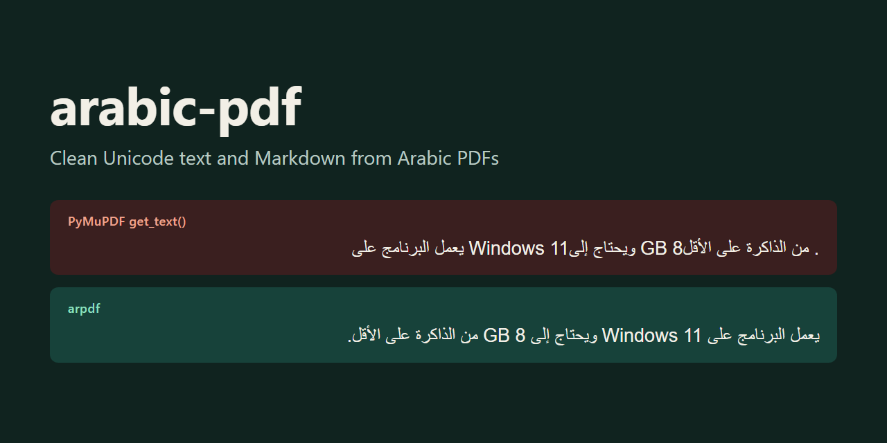
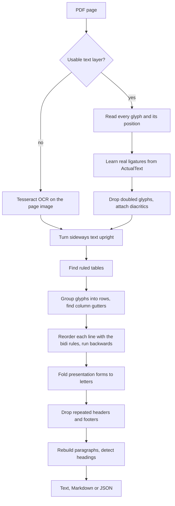

# arabic-pdf

<p align="center">
  
</p>

<p align="center">
  
  
  
</p>

Turn Arabic and mixed Arabic/English PDFs into clean Unicode text, Markdown and JSON.

`arpdf` reads where every glyph is painted on the page and rebuilds the text from that: reading order, real Arabic letters, numbers and English in the right place, columns, tables and headings. Scanned pages go through Tesseract on your own machine. There is no network call in the library, so nothing is uploaded anywhere.

```bash
arpdf report.pdf -o report.md
```

## What goes wrong in other extractors

A PDF does not store text. It stores instructions to paint glyphs at positions, and Arabic breaks most of the assumptions extractors make when they turn those glyphs back into text. These are real outputs: the first four come from `corpus/legacy_mixed_arial.pdf`, the last two from a [Qatar government report](#real-documents).

| Failure | Tool | What it returned | arpdf |
|---|---|---|---|
| Words reversed, letters are shape codes | pdfplumber | `.ﻞﻗﻷﺍ ﻰﻠﻋ ﺓﺮﻛﺍﺬﻟﺍ ﻦﻣ` | `من الذاكرة على الأقل.` |
| English and numbers in the wrong place | PyMuPDF | `ﻭﻳﺤﺘﺎﺝ ﺇﻟﻰWindows 11 ﻳﻌﻤﻞ` | `يعمل البرنامج على Windows 11 ويحتاج إلى` |
| Ligature broken by the usual fix | pdfplumber + NFKC + python-bidi | `األقل` | `الأقل` |
| Number and unit swapped | pdfplumber + NFKC + python-bidi | `GB 8` | `8 GB` |
| Letters swapped around ligatures | PyMuPDF | `اجلزء االول` | `الجزء الاول` |
| A letter missing from the file's own Unicode map | PyMuPDF | `الطاب` | `الطلاب` |

The last row is the sneaky one. It looks almost right, and no cleaning of the extracted text can fix it, because the letter was never there.

## Install and use

```bash
git clone https://github.com/Ifazawezk/arabic-pdf
cd arabic-pdf
pip install -e .
```

```bash
arpdf report.pdf                       # text to stdout
arpdf report.pdf -o report.md          # the format follows the extension
arpdf report.pdf -o report.json        # pages and blocks with positions
arpdf report.pdf -f markdown -p 1-3,7  # chosen pages
arpdf scans/ -o out/ -f markdown       # a whole folder
arpdf scans/ -o out/ -r                # with subfolders
```

| Option | Meaning |
|---|---|
| `-o, --output` | Output file, or a folder for several inputs |
| `-f, --format` | `text`, `markdown` or `json` |
| `-p, --pages` | Pages to read, for example `1-3,7` |
| `-r, --recursive` | Search folders recursively |
| `--ocr` | `auto` (default), `always` or `never` |
| `--ocr-lang` | Tesseract languages, default `ara+eng` |
| `--ocr-dpi` | OCR resolution, default 300 |
| `--keep-headers` | Keep repeated headers, footers and page numbers |
| `--no-tables` | Read tables as plain text |

In a batch, a file that fails is reported on stderr and the rest carry on. The exit code is 1 if anything failed.

From Python:

```python
from arabic_pdf import extract, extract_markdown, extract_text

text = extract_text("report.pdf")
markdown = extract_markdown("report.pdf", pages=[1, 2, 3])

document = extract("report.pdf")
for page in document.pages:
    print(page.number, page.ocr, page.needs_ocr, page.unmapped_glyphs)
    for block in page.blocks:
        print(block.kind, block.level, block.bbox, block.text or block.rows)
```

`page.needs_ocr` tells a scanned page apart from a blank one when OCR is off or missing. `page.unmapped_glyphs` counts glyphs the PDF gives no Unicode value for. Those appear in the text as U+FFFD, not as a guess. Tables keep reading order, so in an Arabic table the first cell of a row is the rightmost one.

### OCR setup

PyMuPDF ships with Tesseract built in, so there is no program to install, only the language data:

1. Download [`ara.traineddata`](https://github.com/tesseract-ocr/tessdata_best/raw/main/ara.traineddata) and [`eng.traineddata`](https://github.com/tesseract-ocr/tessdata_best/raw/main/eng.traineddata) into a folder.
2. Point `TESSDATA_PREFIX` at that folder.

```bash
# Linux and macOS
export TESSDATA_PREFIX="$HOME/.local/share/tessdata"
```

```powershell
# Windows: this folder is also found without the variable
setx TESSDATA_PREFIX "%LOCALAPPDATA%\tessdata"
```

If you already have Tesseract with Arabic data, for example from the [UB Mannheim build](https://github.com/UB-Mannheim/tesseract/wiki) (its installer needs administrator rights) or `apt install tesseract-ocr-ara`, its usual data folder is found automatically. Without the data arpdf still runs: text pages are read normally, and scanned pages come back empty with a warning.

OCR runs on a page when it has fewer than 20 glyphs and images cover at least 30% of it, or when more than 30% of its glyphs have no Unicode value.

## Benchmark

24 PDFs (28 pages) built from known text, so the ground truth is exact. Lower CER is better, higher word order is better.

| Extractor | CER | Word order | Simple | Mixed | Columns | Headers | Tables | Diacritics | Scanned | Time / page |
|---|---:|---:|---:|---:|---:|---:|---:|---:|---:|---:|
| pdftotext (xpdf 4.06) | 51.7% | 45.6% | 35.7% | 25.9% | 72.7% | 47.9% | 60.0% | 44.2% | 100.0% | 19 ms |
| PyMuPDF `get_text()` | 46.2% | 35.3% | 39.3% | 57.8% | 30.5% | 49.9% | 26.3% | 70.3% | 100.0% | 5 ms |
| pdfplumber `extract_text()` | 87.2% | 5.3% | 88.3% | 69.0% | 89.4% | 93.1% | 77.6% | 92.1% | 100.0% | 39 ms |
| pdfplumber + NFKC + python-bidi | 28.6% | 57.0% | 5.0% | 10.6% | 56.1% | 13.2% | 27.5% | 64.8% | 100.0% | 33 ms |
| arpdf | 1.1% | 97.1% | 0.1% | 0.5% | 0.0% | 0.0% | 0.0% | 0.0% | 12.2% | 45 ms |

The category columns show CER. Time covers pages with a text layer; on scanned pages the OCR engine takes over and a page takes a few seconds. Per-document numbers are in [bench/results.md](bench/results.md).

arpdf was developed against this corpus, so 0.0% means "this case is handled", not "expect 0.0% on your files". The two biggest bugs in the project didn't show up in this table at all, only in the [real documents](#real-documents) below.

CER is the edit distance to the ground truth divided by its length, over the whole corpus. Both sides are NFC normalized and whitespace is collapsed, and nothing else is forgiven: a presentation form counts as a wrong character, because that's what a search index would see. Word order is the share of adjacent word pairs from the ground truth that appear in the same order in the output, so reversed text scores near 0. Headers and footers are not part of the ground truth, because the goal is the body text, which counts against tools that keep them; read the Headers column with that in mind.

Running python-bidi on another extractor's output is the `pdfplumber + NFKC + python-bidi` row. It helps a lot on simple pages (5.0% CER), but by then the text is already flattened: ligatures get reversed, and it can't see columns or tables.

The corpus has PDFs from two engines. `legacy` documents use reportlab with arabic-reshaper and python-bidi, which stores presentation forms in visual order like many older reporting tools. `browser` documents are printed by headless Edge, with a real shaping engine, like Word or Google Docs. Eight fonts are covered, including Arabic Typesetting and Sakkal Majalla. `scanned` documents are image-only.

```bash
pip install -e ".[dev,bench]"
python bench/run_bench.py
```

### Real documents

These have no ground truth, so they are checks by reading and counting, not scores. The files belong to their publishers and are not in this repo. `python bench/real_world.py` downloads them, identifies itself as `arabic-pdf-benchmark`, skips and reports a source that refuses instead of retrying, and rejects anything that isn't a PDF, because some hosts answer with an HTML page. It is the only part of the project that downloads anything, and only when you run it.

| Document | Source | Result |
|---|---|---|
| Qatar Second National Development Strategy 2018-2022, 332 pages | [Planning and Statistics Authority, via FAOLEX](https://faolex.fao.org/docs/pdf/qat181692.pdf) | Reads well, sideways tables included |
| Constitution of the World Health Organization, 18 pages | [WHO Basic Documents](https://apps.who.int/gb/bd/PDF/bd47/AR/constitution-ar.pdf) | No Unicode map at all, so arpdf sends it to OCR |

The synthetic corpus could not have shown any of these problems:

- Some pages hold their table rotated 90 degrees. An early version dropped rotated text as watermarks and lost 12.6% of the letters in a sample of 48 pages without any error. Sideways text is now read in its own orientation, and the same check finds 0.44% of the raw letters missing. The output also has 0.96% more letters than the raw layer, mostly letters restored by the next fix.
- The strategy document maps a lam-alef glyph to plain alef, and declares the truth in `/ActualText` on only some occurrences. arpdf learns what each glyph is from the places it is declared. Across the whole document, the word for "the students" comes out right 28 times of 28. PyMuPDF gets it right 0 times.
- Chrome and reportlab map a mirrored bracket by its shape, Adobe tools by the character it stands for, and the file doesn't say which. arpdf tries both and keeps the reading where the brackets balance.
- Some Arabic-Indic digits exist only in `/ActualText`, on top of a glyph mapped to a Western digit.

## How it works



`get_texttrace()` gives each glyph as it is painted, which keeps MuPDF's own line building and partial right-to-left handling out of the way.

Reordering has to happen before normalizing. A lam-alef ligature is one glyph for two letters; expand it first and reversing the line swaps the letters, which is how `لا` becomes `ال`. arpdf moves whole glyphs, then expands them. NFKC alone fixes letter shapes, not order, and applied too early it breaks ligatures. It also rewrites things you may want to keep, so arpdf only folds Arabic presentation forms and Latin ligatures. Tatweel characters are removed, because in PDFs they are almost always justification, not content; `fold(text, keep_tatweel=True)` keeps them if you call it yourself.

The bidi algorithm (UAX #9) turns logical order into visual order. Its level rules also work from visual input, so each glyph gets a level from its class and neighbours, and runs are reversed from the highest level down.

A number next to Arabic text is an Arabic number, so it doesn't absorb `%` (rule W2, and why `87.5%` is painted as `%87.5`). One case can't be solved from geometry: `Windows 11` and `500 QAR` are painted the same way, Latin word on the left. The number joins the Latin run unless the word is a known unit or currency.

A column gutter is a hole at the same x position in many rows. Lines that cross it, like a title, split the page into bands. Columns are read right to left on an Arabic page.

## Other tools

Compiled from each project's own documentation on 2026-10-30. These tools were not run here, so this is a feature comparison, not a test result.

| | arpdf | [qalam](https://github.com/misraj-ai/qalam) | [pdf2text-arabic](https://github.com/TajEddineMarmoul/PDF2Text-Arabic) | [arabic-extract](https://github.com/balswyan/arabic-extract) |
|---|---|---|---|---|
| Built on | PyMuPDF | Rust core | PyMuPDF | pdfplumber, arabic-repair |
| Reorders and folds Arabic | Yes | Yes | Yes | Yes |
| Columns | Yes | Yes | Partly (side by side tables) | Not mentioned |
| Tables | Markdown | Rows, HTML | Separator text | Not mentioned |
| Markdown output | Yes | Through HTML | No | No |
| OCR | Local Tesseract | None, flags the page | Cloud API, pages leave your machine | Local Tesseract or EasyOCR |
| Published benchmark | Yes, reproducible | None found | None | None for itself |
| Python | 3.10+ | 3.9+ | 3.13+ | 3.9+ |

qalam is the closest project. If you only have digital PDFs, or you want its per-page verdicts, look at it. [harfix](https://pypi.org/project/harfix/) is also worth knowing: it audits text that has already been extracted, and can repair it. General document converters such as Docling and Marker were not compared.

## Limitations

- Tested on Windows 11 with Python 3.12 only. The code is not Windows specific, but it has not been run elsewhere.
- Numbers between scripts are ambiguous. `الإجمالي 7,350 QAR` inside an English sentence is painted the same as `7,350 الإجمالي QAR`. This is the 2.8% on `browser_english_arabic`, the largest error on a text layer in the corpus. The unit list helps, but it is a heuristic.
- With Arabic Typesetting and Sakkal Majalla, a browser leaves some glyphs with no Unicode value. They come out as U+FFFD (0.6% and 0.3% CER on those documents) and are counted in `page.unmapped_glyphs`.
- If a glyph is mapped to the wrong letter and the file has no `/ActualText` saying otherwise, arpdf can't detect it and returns the wrong letter.
- OCR is a fallback, and it is uneven: 7.6% and 17.4% CER on the two scanned documents, with word order near 70%. Tesseract can drop whole lines, and with `ara+eng` it sometimes reads a short Arabic word as Latin. Results also move around between DPI settings with no clear winner, so don't expect one setting to fix a page.
- Tables are found from ruled lines in the PDF, so a table without lines is read as text, and tables in scans are not rebuilt. A scanned table scored about 66% CER in a side test, because Tesseract dropped most of it.
- Headers and footers are found in the top and bottom margins. Chapter tabs on the side of a page are kept, as seen in the strategy document.
- Arabic poetry set in two half lines may be read as two columns.
- Paragraphs do not continue across pages, and hyphenated English words are not rejoined.
- Headings come from font size. A heading that is only bold, at body size, stays a paragraph.
- Persian and Urdu keep their letters when the page has letters specific to them, but they are not in the benchmark.

Still to do: publish on PyPI, build a hold-out corpus of real PDFs with hand-checked ground truth, read tables without ruled lines, rebuild tables in scanned pages, retry OCR on regions where lines were dropped, continue paragraphs across pages, recover unmapped glyphs by matching their shapes, and run the benchmark against qalam and other extractors.

## Contributing

The most useful contribution is a PDF that fails. [CONTRIBUTING.md](CONTRIBUTING.md) shows how to turn one into a test case.

## License

[MIT](LICENSE). Copyright (c) 2026 Mohaned Elhagar.
